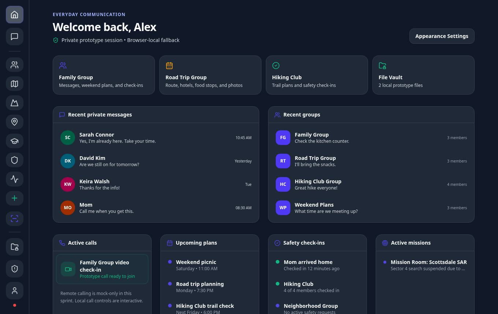

# Project AegisNet

A civilian communications prototype for direct messages, group chats, shared files, and optional coordination exercises. The repository also includes SkyMesh Scout, a situational-awareness dashboard, and a CAP-inspired training board.

[Setup and troubleshooting](docs/Getting-Started.md) · [Screenshot gallery](docs/Screenshots.md) · [Verification and limitations](docs/Verification.md)

## What you can try

| Component | What it demonstrates | Source |
| --- | --- | --- |
| AegisNet web | Messages, Networks, rooms, browser File Vault, simulated calls, and training coordination | [src](src) |
| AegisNet API | Seeded SQLite data, message persistence, attachments, and WebSocket events | [services/api](services/api) |
| SkyMesh Scout | Simulated aircraft and other tracking displays, connection status, node setup, and projector controls | [components/skymesh-scout](components/skymesh-scout) |
| CAP-inspired Mission Board | A fictional training exercise with simulated status, tasking, and transport information | [components/cap](components/cap) |
| Expo and Go scaffolds | Starter code for future native and transport work | [Expo](apps/mobile) · [Go](services/daemon) |

## Quick start

Use Node.js 24 LTS and npm. Clone the repository or download its source ZIP and extract it. Open a terminal in the extracted project folder.

- Windows: run `Start-AegisNet.bat`.
- macOS or Linux: run `bash ./Start-AegisNet.sh`.
- Open [AegisNet](http://localhost:5173) and choose Open Prototype.
- To run only the web UI, run `npm ci` then `npm run dev` from the repo root.

The API listens on loopback at port 8000. The web UI can fall back to browser-local demo data if the API is unavailable. Use fictional data only. The prototype uses demo identity and simulated calls, and lacks production authentication and end-to-end encrypted messaging.

The API refuses production startup and production HTTP requests while demo identity
is in use. This is a development prototype, not a deployable private communications
service. For the November 25 owner/Claude pass, use the [Windows checklist](docs/Windows%20Verification.md).

For SkyMesh Scout and the Mission Board, see the [setup guide](docs/Getting-Started.md). The CAP-inspired board is a training demo with no claim of Civil Air Patrol approval or operational readiness.

## Project documentation

- [Getting started](docs/Getting-Started.md)
- [Screenshots](docs/Screenshots.md)
- [Verification and known limits](docs/Verification.md)
- [Contributor handoff](PROJECT_HANDOFF_REQUIRED.md)
- [Attributions](ATTRIBUTIONS.md)
