# Screenshot gallery

These screenshots were captured from the running project with fresh demo data. The mobile image shows the responsive web app.

## AegisNet

| Dashboard | Direct message |
| --- | --- |
| 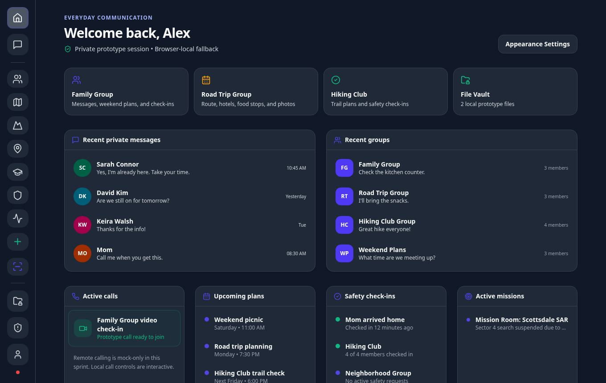 | 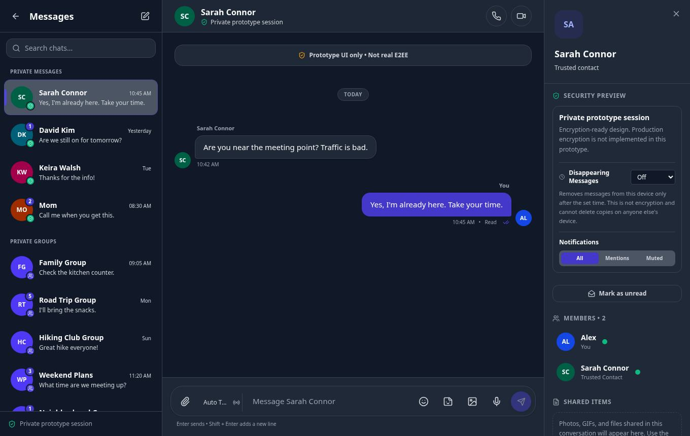 |

| Network room | File Vault |
| --- | --- |
| 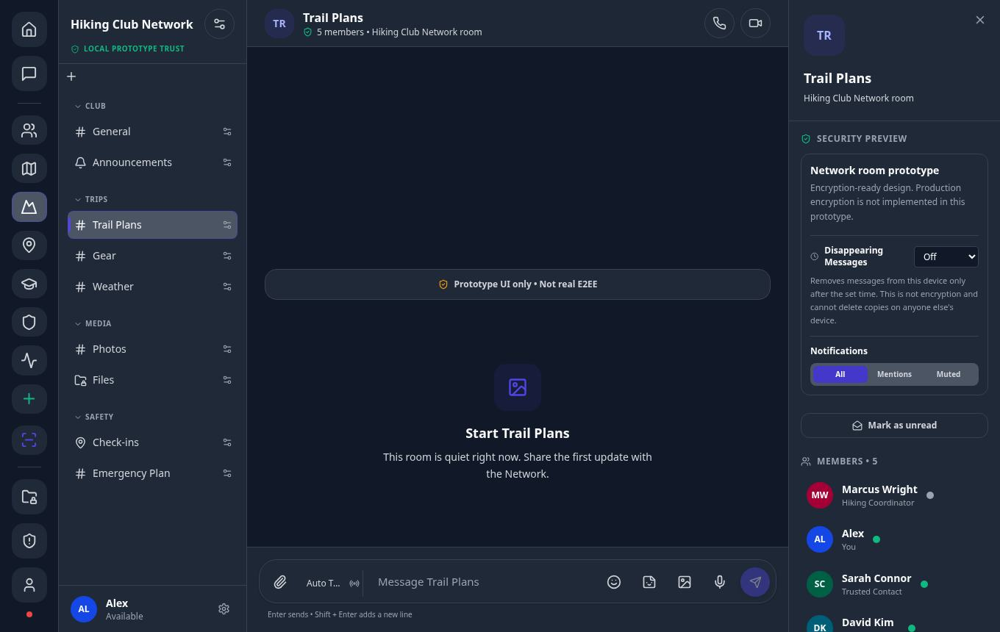 | 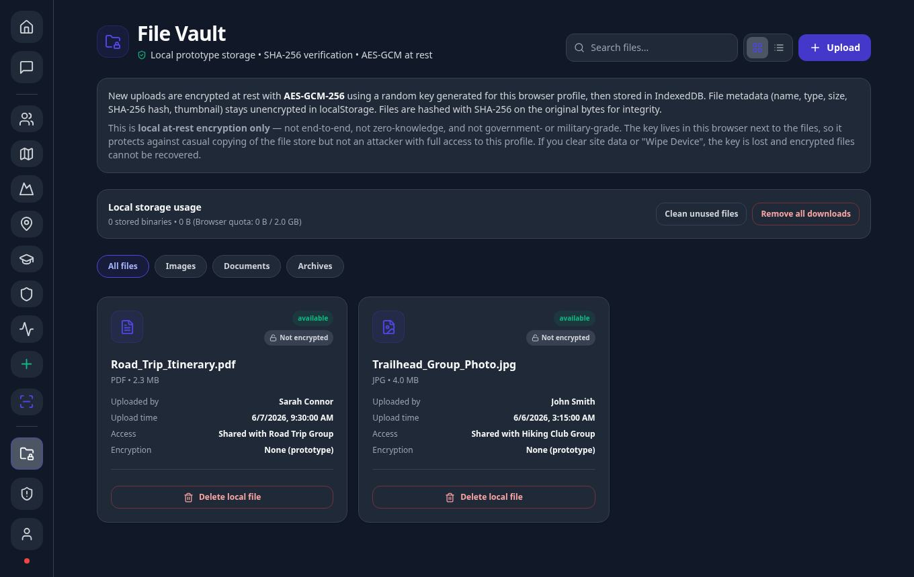 |

| Mission Room | Responsive mobile dashboard |
| --- | --- |
| 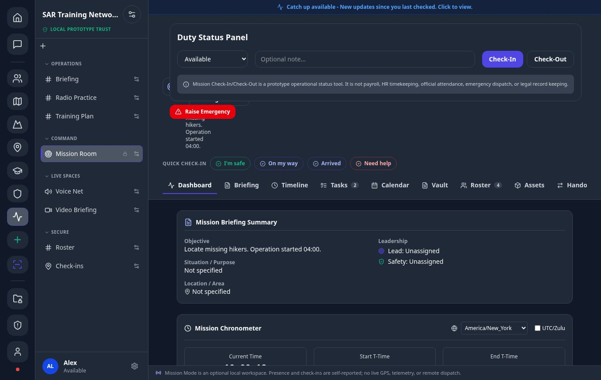 | 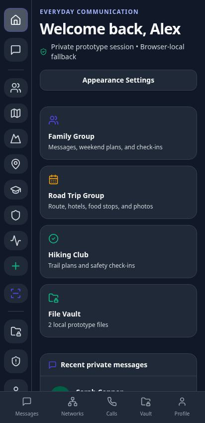 |

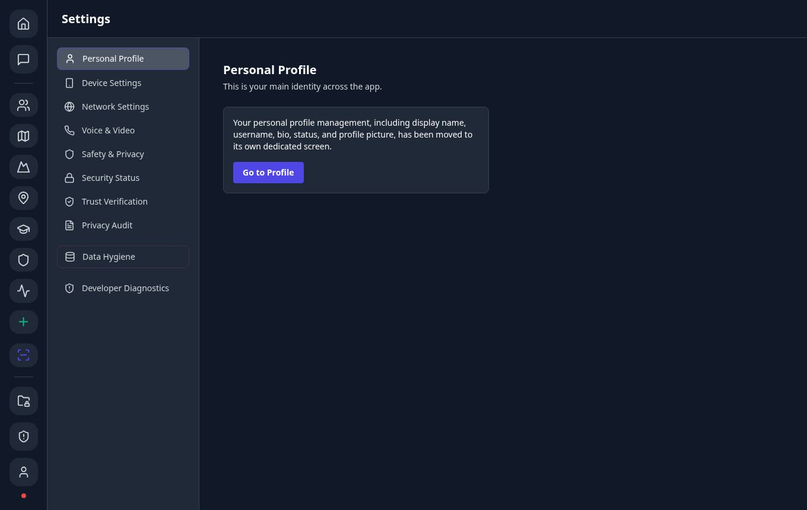

## SkyMesh Scout

| Simulated aircraft | Communications dashboard |
| --- | --- |
| 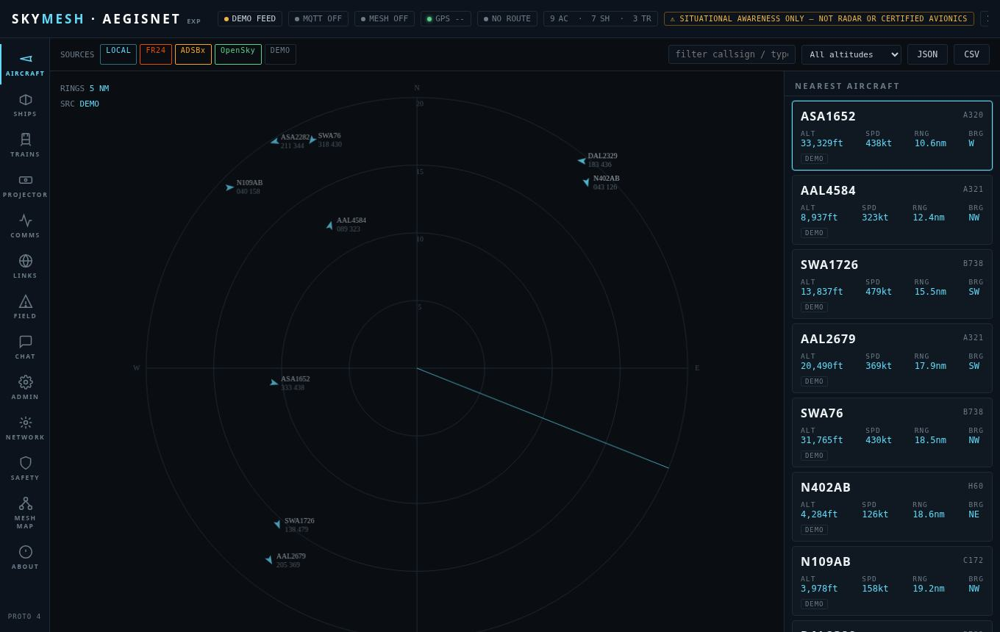 | 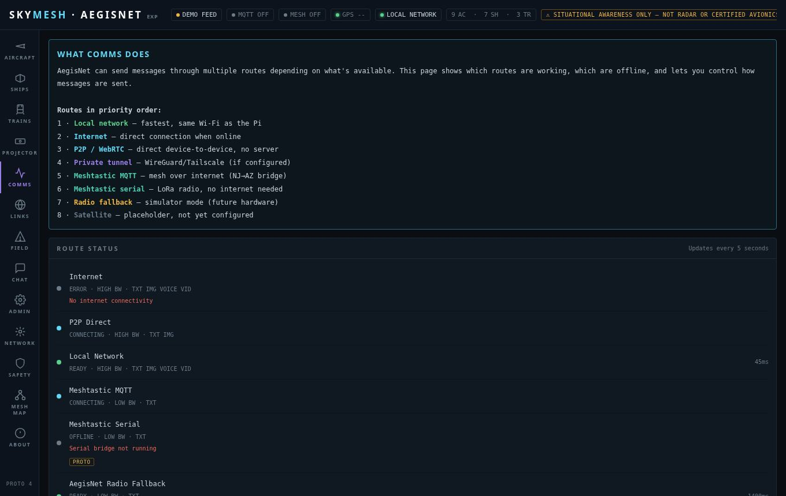 |

| Projector display | Node setup wizard |
| --- | --- |
| 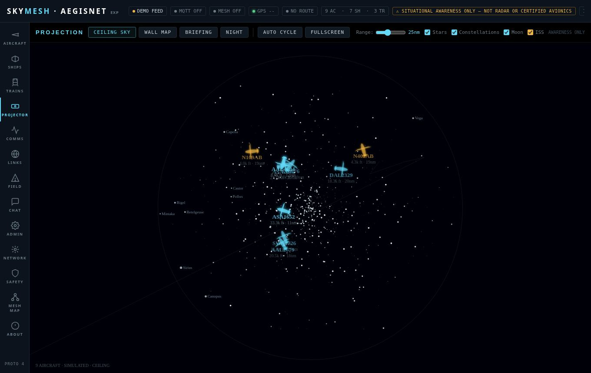 | 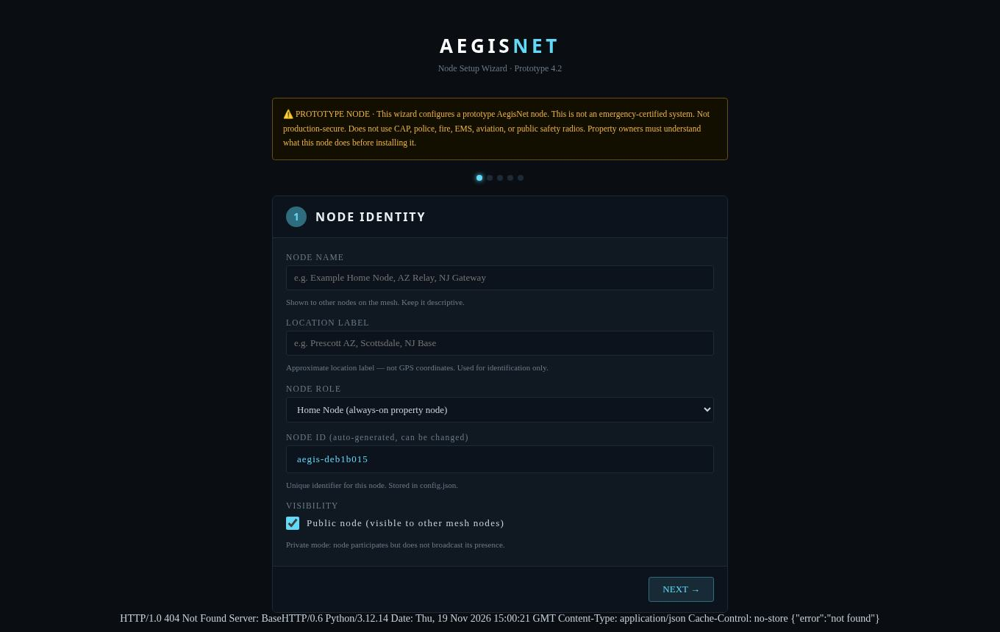 |

## CAP-inspired Mission Board

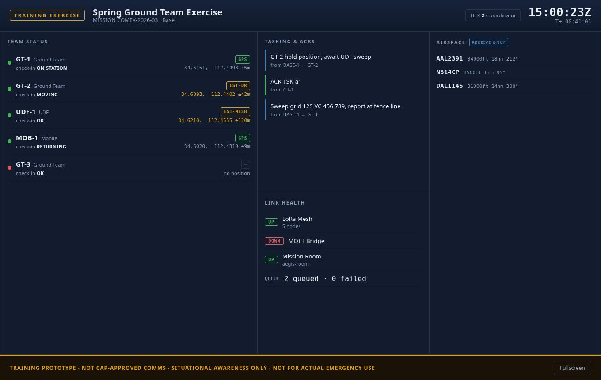
